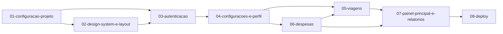
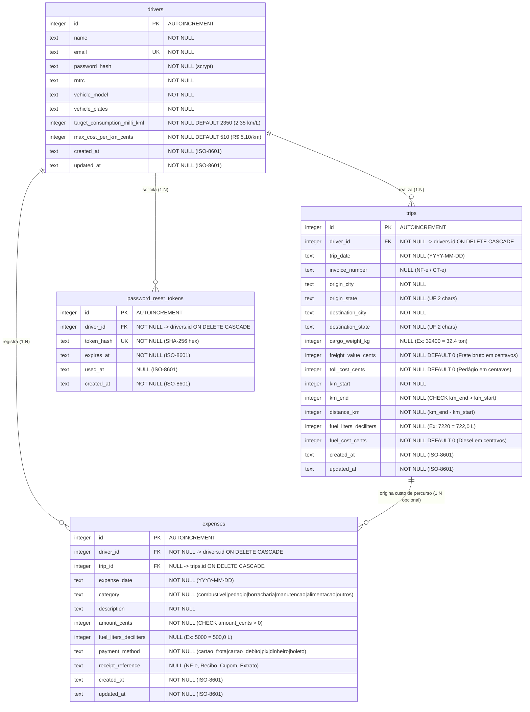

# 00 — Visão Geral da Arquitetura e Especificações (Estrada+)

## 1. Introdução e Objetivo

Este documento consolida a visão geral arquitetural, o resultado da auditoria do repositório (**Fase 0**), o inventário funcional completo do mockup [estrada-desktop.html](file:///Users/vinicius.canedo/Documents/trae_projects/estrada_mais_web/estrada-desktop.html) (**Fase 1**), a lista de módulos e ordem de implementação aprovada, o modelo entidade-relacionamento (ER) unificado e as convenções transversais que regem todas as especificações técnicas em `docs/raw_specs/`.

O **Estrada+** é um sistema web de telemetria de percurso e controle de custos operacionais voltado a **Motoristas Autônomos de Carga Pesada (TAC / Owner-Operators)**, construído com **Nuxt 4**, **TypeScript estrito**, **@nuxt/ui v4**, **Tailwind CSS v4**, **Drizzle ORM + SQLite (`better-sqlite3`)** e **Zod 4** isomórfico.

---

## 2. Resultado da Auditoria do Repositório (Fase 0)

### 2.1 Diagnóstico do Estado Atual

O repositório atual é derivado de um template corporativo (`nuxt_scaffolding`) já configurado com Nuxt `4.6.2`, Vue `3.5.44`, `@nuxt/ui` `4.12.0`, Tailwind CSS `4.3.3`, Pinia `4.1.0`, Zod `4.6.7`, `nuxt-security` `2.7.0` e um conjunto robusto de _Quality Gates_ (`eslint`, `prettier`, `vue-tsc`, `dependency-cruiser`, `jscpd`, `knip`, `vitest`, `playwright`, `secretlint`, `husky`, `commitlint`).

Durante a auditoria somente leitura, foram identificados os seguintes pontos que serão endereçados na etapa de implementação (detalhados em [`01-configuracao-projeto.md`](./01-configuracao-projeto.md)):

1. **Ausência da camada de persistência Drizzle/SQLite:**
   - Não estão instalados `drizzle-orm`, `better-sqlite3`, `@types/better-sqlite3`, `drizzle-kit` nem `drizzle-seed`.
   - Não existem os diretórios `server/database/` (conexão, schema, migrations e seeds) nem `server/repositories/`.
2. **Acoplamento ao Orval no template original:**
   - A `.agents/CONSTITUTION.md` (v1.2.0) e o `package.json` atuais preveem geração de cliente HTTP via `orval` a partir de `openapi.json` em `shared/http/`.
   - Como o Estrada+ utiliza a API interna do Nuxt 4 (`server/api/**`) com schemas Zod compartilhados em `shared/schemas/**`, manter o Orval exigiria duplicar contratos manualmente em `openapi.json` (violando DRY). O Orval e seus artefatos serão removidos.
3. **Lacunas nos Gates de Arquitetura e CI:**
   - `.dependency-cruiser.cjs` valida `api-via-services` e `repos-not-to-services`, mas ainda não impede que `app/**`, `server/api/**` ou `server/services/**` importem `drizzle-orm`, `better-sqlite3` ou `server/database/**` diretamente, nem impede que `server/api/**` deixe de passar por `server/services/**`.
   - O workflow `.github/workflows/quality.yml` (descrito no Apêndice A.8 da Constituição) não existe no repositório.
   - O script `npm run test:load` aponta para `test/load/load.js`, arquivo inexistente (apenas `test/load/smoke.js` existe).
4. **Problemas em `.gitignore` e Docker:**
   - `.gitignore` ignora indevidamente `docs/` e `estrada-desktop.html` e não ignora artefatos de banco SQLite (`*.db`, `*.db-wal`, `*.db-shm`, `*.sqlite*`).
   - `docker/prod/Dockerfile` e `docker-compose.prod.yml` não copiam os binários nativos do `better-sqlite3` nem as migrations do Drizzle para o estágio `runner`, e não montam volume persistente para o banco SQLite.

### 2.2 Documentação Oficial Consultada via MCP do Nuxt (`nuxt`)

Todos os padrões adotados nestas especificações foram validados contra a documentação oficial do **Nuxt 4.x** usando o servidor MCP `nuxt`:

| Tópico                                    | Página / Recurso Consultada no MCP `nuxt`                                               | Padrão Oficial Adotado                                                                                                                                                                                                                                                                       |
| :---------------------------------------- | :-------------------------------------------------------------------------------------- | :------------------------------------------------------------------------------------------------------------------------------------------------------------------------------------------------------------------------------------------------------------------------------------------- |
| **Estrutura de Diretórios Nuxt 4**        | `/docs/4.x/getting-started/upgrade#new-directory-structure`                             | `srcDir` padrão em `app/`, `server/` e `shared/` na raiz do projeto; alias `~` aponta para `app/`, `#server` para `server/` e `#shared` para `shared/`.                                                                                                                                      |
| **Diretório `shared/` e Auto-imports**    | `/docs/4.x/directory-structure/shared`                                                  | Apenas arquivos no nível raiz de `shared/utils/` e `shared/types/` sofrem auto-import. Schemas organizados por domínio em `shared/schemas/*.schema.ts` são importados explicitamente via `#shared/schemas/...`.                                                                              |
| **Rotas de Servidor, Validação e Sessão** | `/docs/4.x/directory-structure/server` e `/docs/4.x/guide/going-further/server-imports` | Uso de `defineEventHandler` / `defineHandler`, validação de entrada com `readValidatedBody`, `getValidatedQuery` e `getValidatedRouterParams` passando schemas Zod (compatíveis com Standard Schema), e gerenciamento de sessão selada com `useSession` (`nuxt/server` + `NUXT_APP_SECRET`). |
| **Data Fetching SSR & Client**            | `/docs/4.x/getting-started/data-fetching`                                               | `useApiFetch` (wrapper sobre `useFetch`) com chave explícita/estável para leitura SSR/CSR sem dupla requisição; `$fetch` exclusivo para mutações imperativas (`POST`, `PUT`, `PATCH`, `DELETE`) disparadas por eventos do usuário.                                                           |
| **Composables**                           | `/docs/4.x/directory-structure/app/composables`                                         | Composables nomeados com prefixo `use` na raiz de `app/composables/`, retornando estado e métodos explicitamente tipados.                                                                                                                                                                    |
| **Tratamento de Erros**                   | `/docs/4.x/getting-started/error-handling`                                              | Uso de `createError({ status, statusText, message, data })` no servidor (com `statusText` restrito a ASCII curto e `message` em `pt-BR`), página global `app/error.vue` e `<NuxtErrorBoundary>` em seções críticas.                                                                          |
| **Build e Deploy Node.js**                | `/docs/4.x/getting-started/deployment`                                                  | Preset `node-server` gerando `.output/server/index.mjs`, executado com `NODE_ENV=production`, `NITRO_HOST=0.0.0.0` e `NITRO_PORT=3000`.                                                                                                                                                      |

---

## 3. Resumo do Inventário do Mockup (Fase 1)

O arquivo [estrada-desktop.html](file:///Users/vinicius.canedo/Documents/trae_projects/estrada_mais_web/estrada-desktop.html) contém 5 telas principais, 2 modais interativos e elementos persistentes de navegação:

1. **Shell Persistente (Sidebar Esquerda + Top Bar):**
   - **Sidebar:** Identidade visual `ESTRADA+` ("Owner-Operator Telematics"), menu com 5 itens (`Painel Principal`, `Viagens (Trips)` com badge de contagem, `Despesas (Ledger)` com badge azul de contagem, `Sistema de Design [SPEC]` restrito a `dev`, e `Configurações`), badge de status de telemetria (`SYNC OK • Há X min • 4G LTE`) e mini-perfil do motorista (`Valdir Silveira`, `Scania R450 • 6x2`) com botão `Desconectar`.
   - **Top Bar:** Breadcrumb dinâmico por tela, seletor global de competência mensal (`← SETEMBRO 2026 →`) e botões de ação rápida `+ Lançar Despesa` e `+ Registrar Viagem`.
2. **Tela 1 — Painel Principal (`#screen-dashboard`):**
   - **Hero Card (`Indicador Mestre`):** `Custo Médio Operacional (R$/km)`, badge de meta (`META: ≤ R$ 5,10`), comparativo percentual e em R$/km contra o mês anterior e barra proporcional de composição (`Combustível %`, `Pedágio %`, `Manutenção/Outros %`).
   - **Grid de 8 Indicadores Secundários:** `KM Rodados` (com delta vs. mês anterior), `Média Diesel (km/L)` (comparado à meta), `Combustível` (total R$, litros, preço médio/L, nº de abastecimentos), `Pedágios` (total R$, R$/km, qtd), `Borracharia` (total R$, resumo), `Manutenção` (total R$, resumo), `Alimentação` (total R$, diárias, média/dia) e `Sobra Líquida` (`Fretes - Despesas` e `% Margem do Bruto`).
   - **Gráfico de Evolução (Últimos 6 Meses):** Gráfico SVG de barras empilhadas (`Diesel`, `Pedágio`, `Manutenção/Outros`) + linha de tendência do `Total R$/km`.
   - **Tabelas Resumo:** Últimas 5 viagens registradas e últimas 5 despesas operacionais da competência selecionada.
3. **Tela 2 — Viagens (`#screen-trips`) + Modal `Registrar Nova Viagem` (`#modal-log-trip`):**
   - Filtros por texto (origem, destino, NF-e), período (`Mês Selecionado`, `Últimos 90 dias`, `Ano Completo`) e tag de UF (`TODOS`, `SP`, `PR`, `MT`, etc.).
   - Tabela com ordenação nas colunas `DATA`, `ROTA`, `KM RODADOS`, `KM/L` e `CUSTO/KM`, ações de editar/excluir e rodapé consolidado (`TOTAIS`).
   - Modal com cálculo reativo em tempo real de `KM Rodados = KM Final - KM Inicial` (bloqueando `KM Final <= KM Inicial`) e `Consumo Médio = Distância / Litros`, além do campo de **Valor do Frete Bruto (R$)** e sincronização automática de custos de diesel/pedágio da viagem no Ledger de Despesas.
4. **Tela 3 — Despesas (`#screen-expenses`) + Modal `Lançar Nova Despesa` (`#modal-log-expense`):**
   - Barra de filtro por categoria com contadores (`TODAS`, `Combustível`, `Pedágios`, `Borracharia`, `Manutenção`, `Alimentação`, `Outros`).
   - Tabela com cálculo automático de `Preço/L` para abastecimentos, meio de pagamento, badge de comprovante (`NF-e`, `Recibo`, `Cupom`, `Extrato`) e ações de editar/excluir.
5. **Tela 4 — Sistema de Design (`#screen-design-system`):**
   - Catálogo vivo da direção estética **"Night Highway"** (tokens OKLCH/Hex, tipografia `Oswald` / `Inter` / `JetBrains Mono`, estados de input com unidade embutida e matriz de botões). Visível no menu apenas em ambiente de desenvolvimento.
6. **Tela 5 — Configurações (`#screen-settings`):**
   - Identificação do Transportador Autônomo e Veículo (`Nome Completo`, `Registro RNTRC`, `Cavalo Mecânico`, `Placas`).
   - Segurança & Acesso (`E-mail de Acesso` e `Nova Senha`).
   - Sliders de Metas de Telemetria (`Meta Consumo km/L` de `1.8` a `3.2` e `Teto de Custo Operacional R$/km` de `3.5` a `7.0`).
   - Exportação Contábil (`Baixar Relatório CSV Completo` e `Imprimir Relatório Mensal PDF`).

---

## 4. Lista de Módulos e Ordem de Implementação

A ordem de implementação foi desenhada para respeitar estritamente a árvore de dependências entre camadas de infraestrutura, autenticação, parâmetros de domínio, registros transacionais e consolidação analítica:



| Ordem  | Arquivo da Spec                                                                | Módulo                          | Justificativa de Posição e Dependências                                                                                                                                                                                              |
| :----: | :----------------------------------------------------------------------------- | :------------------------------ | :----------------------------------------------------------------------------------------------------------------------------------------------------------------------------------------------------------------------------------- |
| **01** | [`01-configuracao-projeto.md`](./01-configuracao-projeto.md)                   | `configuracao-projeto`          | **Fixo (Primeiro).** Configura Drizzle/SQLite, limpa artefatos do Orval/template, atualiza a `CONSTITUTION.md` e endurece os gates de arquitetura antes de qualquer código de domínio.                                               |
| **02** | [`02-design-system-e-layout.md`](./02-design-system-e-layout.md)               | `design-system-e-layout`        | Define os tokens "Night Highway", fontes, componentes base de input com unidade inline, estado global de competência mensal, badge `SYNC OK` e o shell `default.vue`.                                                                |
| **03** | [`03-autenticacao.md`](./03-autenticacao.md)                                   | `autenticacao`                  | Cria a tabela base `drivers` (credenciais) e `password_reset_tokens`, sessão `useSession`, rate limiting, telas públicas de Login e Recuperação de Senha via Magic Link e middleware de proteção das demais rotas.                   |
| **04** | [`04-configuracoes-e-perfil.md`](./04-configuracoes-e-perfil.md)               | `configuracoes-e-perfil`        | Gerencia os dados cadastrais do motorista/veículo (exibidos na Sidebar) e as **Metas de Telemetria** (`targetConsumptionMilliKml`, `maxCostPerKmCents`) consumidas pelo Dashboard.                                                   |
| **05** | [`05-viagens.md`](./05-viagens.md)                                             | `viagens`                       | Implementa o CRUD de viagens (`trips`) e a sincronização transacional de seus custos de diesel e pedágio com o Ledger de Despesas (`expenses`).                                                                                      |
| **06** | [`06-despesas.md`](./06-despesas.md)                                           | `despesas`                      | Implementa o CRUD completo do Ledger de Despesas Operacionais (`expenses`), categorias, cálculo de preço/L e filtros por categoria. _(A tabela `expenses` é criada na migration base junto a `trips` para suportar a FK `trip_id`)._ |
| **07** | [`07-painel-principal-e-relatorios.md`](./07-painel-principal-e-relatorios.md) | `painel-principal-e-relatorios` | Depende de `04` (metas), `05` (viagens/fretes/km) e `06` (despesas) para calcular o Custo/KM, Sobra Líquida, gráfico de 6 meses e exportações contábeis CSV e PDF (`@media print`).                                                  |
| **08** | [`08-deploy.md`](./08-deploy.md)                                               | `deploy`                        | **Fixo (Último).** Consolida build de produção, imagem Docker multi-stage com `better-sqlite3`, migrations automáticas no boot, backup de SQLite, CI/CD e observabilidade.                                                           |

---

## 5. Diagrama Entidade-Relacionamento Geral (Mermaid)



---

## 6. Convenções Transversais

### 6.1 Estrutura de Diretórios Canônica

```text
├── .agents/
│   └── CONSTITUTION.md               # Constituição normativa v2.0.0 do projeto Estrada+
├── app/                              # Camada Cliente/SSR (Nuxt 4 srcDir)
│   ├── assets/css/main.css           # Tokens Tailwind CSS v4 + tema Night Highway
│   ├── components/
│   │   ├── ui/                       # Componentes base (UnitInput, TelemetryBadge, RoadDivider)
│   │   ├── dashboard/                # HeroCostCard, SecondaryStatsGrid, CostTrendSvgChart, etc.
│   │   ├── trips/                    # TripsFilterBar, TripsDataTable, TripFormModal
│   │   ├── expenses/                 # ExpensesCategoryBar, ExpensesDataTable, ExpenseFormModal
│   │   └── settings/                 # DriverProfileForm, SecurityForm, TelemetryTargetsCard, AccountingExportCard
│   ├── composables/                  # useApiFetch, useCompetencePeriod, useAuthSession, useTrips, useExpenses, useDashboard, useTelemetrySync
│   ├── layouts/
│   │   ├── default.vue               # Sidebar persistente + Top Bar + slot principal
│   │   ├── auth.vue                  # Layout enxuto Night Highway para Login / Recuperação de Senha
│   │   └── print.vue                 # Layout otimizado @media print para Relatório Mensal PDF
│   ├── middleware/
│   │   └── auth.global.ts            # Proteção de rotas autenticadas
│   ├── pages/
│   │   ├── index.vue                 # Painel Principal (Dashboard)
│   │   ├── trips.vue                 # Histórico Completo de Viagens
│   │   ├── expenses.vue              # Diário de Despesas Operacionais (Ledger)
│   │   ├── settings.vue              # Configurações do Sistema
│   │   ├── design-system.vue         # Catálogo Vivo Night Highway (acessível em dev)
│   │   ├── reports/print.vue         # Visualização de Impressão PDF para Contador
│   │   ├── login.vue                 # Tela de Login
│   │   ├── forgot-password.vue       # Solicitação de Magic Link de recuperação
│   │   └── reset-password.vue        # Redefinição de senha via token do Magic Link
│   ├── stores/                       # Pinia stores quando necessário compartilhamento complexo
│   └── utils/                        # Formatadores visuais (moeda BRL, km, litros, datas pt-BR)
├── server/                           # Camada Backend (Nitro)
│   ├── api/                          # Handlers HTTP finos (validação Zod -> 1 service -> resposta)
│   │   ├── health.get.ts
│   │   ├── auth/                     # login.post.ts, logout.post.ts, me.get.ts, forgot-password.post.ts, reset-password.post.ts
│   │   ├── settings/                 # profile.get.ts, profile.put.ts, credentials.put.ts, targets.put.ts
│   │   ├── trips/                    # index.get.ts, index.post.ts, [id].put.ts, [id].delete.ts
│   │   ├── expenses/                 # index.get.ts, index.post.ts, [id].put.ts, [id].delete.ts
│   │   └── reports/                  # dashboard.get.ts, csv.get.ts
│   ├── database/                     # Infraestrutura de banco (acessada APENAS por repositories e plugin de migration)
│   │   ├── client.ts                 # Instância singleton Drizzle + better-sqlite3 (WAL + FK=ON)
│   │   ├── schema.ts                 # Definição das tabelas Drizzle portáveis
│   │   ├── migrate.ts                # Função utilitária de execução de migrations
│   │   ├── seed.ts                   # Seed de desenvolvimento e factories drizzle-seed
│   │   └── migrations/               # Arquivos SQL gerados pelo drizzle-kit
│   ├── plugins/
│   │   └── 01.database-migrate.ts    # Executa migrations pendentes no boot do servidor Nitro
│   ├── repositories/                 # Único ponto de acesso a dados via Drizzle ORM
│   │   ├── driver.repository.ts
│   │   ├── password-reset.repository.ts
│   │   ├── trip.repository.ts
│   │   └── expense.repository.ts
│   ├── services/                     # Regras de negócio puras e orquestração de repositórios
│   │   ├── health.service.ts
│   │   ├── auth.service.ts
│   │   ├── settings.service.ts
│   │   ├── trip.service.ts
│   │   ├── expense.service.ts
│   │   └── report.service.ts
│   └── utils/                        # Mapeador central de erros HTTP (handleDomainError), mailer SMTP, rate-limiter, criptografia scrypt
├── shared/                           # Código 100% isomórfico e puro (sem imports de app/ ou server/)
│   ├── schemas/                      # Schemas Zod compartilhados entre API e Front-end (UForm)
│   │   ├── common.schema.ts
│   │   ├── auth.schema.ts
│   │   ├── settings.schema.ts
│   │   ├── trip.schema.ts
│   │   ├── expense.schema.ts
│   │   └── report.schema.ts
│   ├── types/                        # Tipos inferidos via z.infer e enums de domínio
│   │   └── domain.ts
│   └── utils/                        # Cálculos puros de telemetria e conversores de unidades (centavos <-> reais, decilitros <-> litros)
│       ├── telematics.ts
│       └── units.ts
└── test/
    ├── arch/                         # layers.spec.ts, docker.spec.ts
    ├── unit/                         # Testes unitários de services, utils e schemas (Node + SQLite :memory: para repos)
    ├── nuxt/                         # Testes de componentes, composables e páginas (@nuxt/test-utils)
    ├── e2e/                          # Fluxos críticos completos com Playwright
    └── load/                         # smoke.js e load.js (k6)
```

### 6.2 Convenções de Nomenclatura e Idioma

- **Idioma:**
  - Interface de usuário, mensagens de validação dos schemas Zod, mensagens de erro de negócio (`message` no `createError`), comentários explicativos ("por quê") e nomes de testes (`it('deve rejeitar viagem com km final menor ou igual ao inicial', ...)`) **DEVEM** ser escritos em **Português do Brasil (`pt-BR`)**.
  - Identificadores de código (variáveis, funções, tipos, tabelas e colunas no banco, rotas de API) **DEVEM** usar inglês técnico consistente (`trips`, `expenses`, `drivers`, `freightValueCents`, `kmStart`), exceto valores de enum de domínio ligados diretamente ao negócio brasileiro (`combustivel`, `pedagio`, `borracharia`, `manutencao`, `alimentacao`, `outros`; `cartao_frota`, `cartao_debito`, `pix`, `dinheiro`, `boleto`).
- **Arquivos:**
  - Componentes Vue: `PascalCase.vue` (ex.: `TripFormModal.vue`).
  - Composables: `camelCase` iniciando com `use` (ex.: `useTrips.ts`).
  - Services, Repositories e Schemas: `kebab-case` com sufixo do papel (ex.: `trip.service.ts`, `trip.repository.ts`, `trip.schema.ts`).

### 6.3 Convenções de Precisão Numérica e Portabilidade de Banco

Para evitar erros de ponto flutuante IEEE 754 em cálculos financeiros e de telemetria e garantir **100% de portabilidade** do schema SQLite para PostgreSQL no futuro:

| Grandeza                          | Tipo no Banco (Drizzle) | Escala Armazenada                    | Exemplo no Banco             | Valor na UI / Input       |
| :-------------------------------- | :---------------------- | :----------------------------------- | :--------------------------- | :------------------------ |
| **Valores Monetários (`R$`)**     | `integer`               | Centavos (`R$ * 100`)                | `346560`                     | `R$ 3.465,60` (`3465.60`) |
| **Volume de Combustível (`L`)**   | `integer`               | Decilitros (`L * 10`)                | `7220`                       | `722,0 L` (`722.0`)       |
| **Peso da Carga (`ton`)**         | `integer`               | Quilogramas (`ton * 1000`)           | `32400`                      | `32,4 ton` (`32.4`)       |
| **Consumo / Eficiência (`km/L`)** | `integer`               | Milésimos de km/L (`km/L * 1000`)    | `2350`                       | `2,35 km/L` (`2.35`)      |
| **Odômetro / Distância (`km`)**   | `integer`               | Quilômetros inteiros (`km`)          | `784320`                     | `784.320 km`              |
| **Datas Operacionais**            | `text`                  | `YYYY-MM-DD` (ISO-8601 local date)   | `'2026-09-15'`               | `15/09/2026`              |
| **Timestamps de Auditoria**       | `text`                  | `YYYY-MM-DDTHH:mm:ss.sssZ` (UTC ISO) | `'2026-09-15T14:30:00.000Z'` | Data/hora local           |

> [!TIP]
> Os schemas Zod de entrada de formulário recebem números decimais amigáveis ao usuário na UI (ex.: `3465.60` reais, `722.0` litros, `32.4` toneladas) ou convertem via utilitários puros em `shared/utils/units.ts` (`toCents`, `fromCents`, `toDeciliters`, `fromDeciliters`, `toKg`, `fromKg`) antes de persistir nos Services/Repositories.

### 6.4 Padrão de Resposta e Tratamento de Erros da API

1. **Formato de Sucesso:**
   - Listagens / coleções: `{ data: T[], meta?: { total: number, summary?: ... } }`
   - Recurso único (GET/POST/PUT): `{ data: T }`
   - Exclusão (DELETE) / Ação simples: `{ success: true }`
2. **Validação de Entrada nos Handlers (`server/api/**`):**
   - Todo handler valida `body`, `query` ou `params` usando `readValidatedBody(event, schema.parse)`, `getValidatedQuery(event, schema.parse)` ou `getValidatedRouterParams(event, schema.parse)`.
   - Quando a validação Zod falha, o utilitário lança HTTP `400 Bad Request` contendo a lista estruturada de `issues` em `pt-BR`.
3. **Erros de Domínio e Mapeamento Único (`server/utils/domain-error.ts`):**
   - Services nunca lançam `createError` do HTTP diretamente; lançam `DomainError` tipado com códigos semânticos:
     - `VALIDATION_ERROR` → `400 Bad Request`
     - `UNAUTHORIZED` → `401 Unauthorized`
     - `FORBIDDEN` → `403 Forbidden`
     - `NOT_FOUND` → `404 Not Found`
     - `CONFLICT` → `409 Conflict`
     - `RATE_LIMITED` → `429 Too Many Requests`
   - Um único helper `handleServiceError(error)` na borda HTTP (`server/utils/domain-error.ts`) converte `DomainError` para `createError({ status, statusText, message, data: { code } })`, garantindo que `statusText` contenha apenas caracteres ASCII visíveis (conforme documentação oficial do Nuxt 4) e `message` traga a mensagem amigável em `pt-BR`, sem jamais vazar stack traces de banco ou infraestrutura para o cliente.
