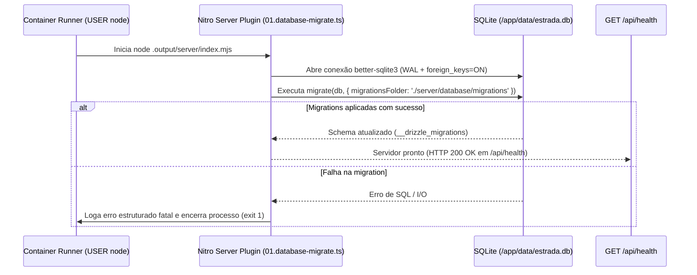

# 08 — Especificação Técnica: Deploy, Operação e CI/CD (`deploy`)

## 1. Visão Geral

Esta especificação consolida a estratégia de build de produção do **Nuxt 4**, empacotamento e orquestração via **Docker / Docker Compose**, gestão de variáveis de ambiente e segredos, execução automatizada de migrations do **Drizzle ORM** no boot do container, persistência e rotina de backup online do **SQLite (`better-sqlite3` em modo WAL)**, verificação de saúde (`HEALTHCHECK`), pipeline de **CI/CD no GitHub Actions** alinhado aos 14 _Quality Gates_ da [`.agents/CONSTITUTION.md`](../../.agents/CONSTITUTION.md), estratégia de rollback e observabilidade básica (logs estruturados).

---

## 2. Build de Produção do Nuxt 4 (Nitro Node Server)

Conforme consultado na documentação oficial do Nuxt 4 (`/docs/4.x/getting-started/deployment` via MCP `nuxt`):

1. **Preset de Compilação:**
   - Utiliza o preset padrão `node-server` do Nitro (`npm run build` / `nuxt build`), gerando o diretório standalone `.output/` composto por:
     - `.output/public/`: ativos estáticos com hash de conteúdo (`_nuxt/*`) para cache imutável.
     - `.output/server/index.mjs`: ponto de entrada do servidor HTTP Node.js.
2. **Externalização Segura do Driver Nativo (`better-sqlite3`):**
   - No `nuxt.config.ts`, o módulo `better-sqlite3` (que possui addon C++ compilado `better_sqlite3.node`) é mantido compatível com o bundler do Nitro para que seus binários nativos sejam copiados integralmente para `.output/server/node_modules/better-sqlite3`.
3. **Comando de Inicialização:**
   ```bash
   NODE_ENV=production NITRO_HOST=0.0.0.0 NITRO_PORT=3000 node .output/server/index.mjs
   ```

---

## 3. Imagem e Orquestração Docker

Baseada nas definições completas da spec [`01-configuracao-projeto.md`](./01-configuracao-projeto.md) (Seção 6):

1. **`docker/prod/Dockerfile` (Multi-Stage):**
   - **Stage 1 (`build` — `node:24-bookworm-slim`):** Instala `python3`, `make` e `g++` apenas durante a construção para garantir a compilação limpa do `better-sqlite3`, executa `npm ci` e `npm run build`.
   - **Stage 2 (`runner` — `node:24-bookworm-slim`):** Imagem limpa sem `devDependencies`, sem compiladores C++ e sem código-fonte bruto. Cria `/app/data` com `chown node:node`, copia `.output/`, `server/database/migrations/` e `package.json`, define `USER node` e expõe a porta `3000`.
2. **`docker-compose.prod.yml`:**
   - Monta o volume nomeado `estrada_sqlite_data` em `/app/data` para persistir o arquivo `estrada.db` e seus arquivos auxiliares `-wal` e `-shm`.
   - Aplica política `restart: unless-stopped` e `healthcheck` nativo.

---

## 4. Variáveis de Ambiente e Gestão de Segredos

| Variável                           | Obrigatória em Prod? | Sensível (Secret)? | Descrição e Regra em Produção                                                                                                                                             |
| :--------------------------------- | :------------------: | :----------------: | :------------------------------------------------------------------------------------------------------------------------------------------------------------------------ |
| `NODE_ENV`                         |         Sim          |        Não         | Deve ser sempre `production`.                                                                                                                                             |
| `NITRO_HOST` / `NITRO_PORT`        |         Sim          |        Não         | `0.0.0.0` e `3000`.                                                                                                                                                       |
| `NUXT_PUBLIC_API_BASE`             |         Sim          |        Não         | `/api` (ou prefixo reverso configurado).                                                                                                                                  |
| `NUXT_PUBLIC_APP_URL`              |         Sim          |        Não         | URL pública HTTPS (ex.: `https://app.estradamais.com.br`), usada na geração do Magic Link de recuperação de senha.                                                        |
| `NUXT_DATABASE_URL`                |         Sim          |        Não         | `/app/data/estrada.db` (apontando para o volume Docker persistente).                                                                                                      |
| `NUXT_APP_SECRET`                  |  **Sim (Crítico)**   |      **Sim**       | Segredo de no mínimo 32 bytes hex (`openssl rand -hex 32`) usado pelo `nuxt/server` (`useSession` / `deriveSecret`) para selar cookies de sessão com criptografia `iron`. |
| `NUXT_SMTP_HOST` / `PORT` / `USER` |         Sim          |        Não         | Host, porta (`587`/`465`) e usuário do servidor SMTP transacional.                                                                                                        |
| `NUXT_SMTP_PASS`                   |         Sim          |      **Sim**       | Senha ou API Key do provedor SMTP.                                                                                                                                        |
| `NUXT_SMTP_FROM`                   |         Sim          |        Não         | Remetente exibido nos e-mails transacionais.                                                                                                                              |

- **Regras de Segurança (§8 da Constituição):**
  - Nenhum segredo é embutido na imagem Docker (`Dockerfile` nunca recebe `ENV NUXT_APP_SECRET` nem copia `.env`).
  - As variáveis são injetadas em runtime via arquivo `.env` restrito no host (`chmod 600 .env`) ou Secret Manager do orquestrador.

---

## 5. Estratégia de Migrations no Deploy



1. **Execução Programática Sem `drizzle-kit` em Produção:**
   - O plugin `server/plugins/01.database-migrate.ts` utiliza `migrate` de `drizzle-orm/better-sqlite3/migrator` apontando para `./server/database/migrations`.
   - As migrations do SQLite no Drizzle rodam dentro de uma transação: se qualquer instrução falhar, o banco faz rollback automático da migration e o processo encerra com código não-zero, impedindo que o container novo assuma tráfego no healthcheck.
2. **Proibição de `Single-Instance Locking` Concorrente:**
   - Como o banco é SQLite em arquivo local, o container de aplicação deve rodar com **1 réplica por volume** (`replicas: 1`) em modo `WAL` (`PRAGMA busy_timeout = 5000;`), evitando contenção de escrita entre múltiplos containers sobre o mesmo arquivo.

---

## 6. Persistência e Backup do SQLite

1. **Configuração de Pragmas de Durabilidade (`server/database/client.ts`):**
   ```sql
   PRAGMA journal_mode = WAL;
   PRAGMA synchronous = NORMAL;
   PRAGMA foreign_keys = ON;
   PRAGMA busy_timeout = 5000;
   ```
2. **Rotina de Backup Online Consistente (`scripts/backup-sqlite.mjs`):**
   - Copiar o arquivo `estrada.db` diretamente via `cp` enquanto o SQLite está em modo WAL pode gerar arquivo incompleto se não incluir o checkpoint do `-wal`.
   - Por isso, o projeto fornecerá o utilitário `scripts/backup-sqlite.mjs` que utiliza a API nativa `.backup(destinationPath)` do `better-sqlite3` (ou `VACUUM INTO`), gerando um snapshot atômico e íntegro mesmo com a aplicação online:
     ```bash
     docker exec estrada-mais-prod node -e "
       import('better-sqlite3').then(({ default: Database }) => {
         const db = new Database('/app/data/estrada.db', { readonly: true });
         return db.backup('/app/data/backup-' + new Date().toISOString().slice(0,10) + '.db');
       })
     "
     ```
   - **Antes de cada deploy de nova versão:** O pipeline/script de atualização dispara um backup imediato (`pre-deploy-YYYYMMDD-HHMMSS.db`) no volume `/app/data/backups/`, mantendo retenção dos últimos 14 snapshots.

---

## 7. Healthcheck

- **Endpoint:** `GET /api/health`
- **Comportamento:**
  - Aciona `HealthService.getHealthStatus()`, que executa `SELECT 1` no SQLite via `HealthRepository`.
  - Se o banco responder dentro do timeout: retorna `200 OK` com `{ status: 'ok', database: 'connected', timestamp }`.
  - Se o banco estiver corrompido, bloqueado ou inacessível: retorna `503 Service Unavailable`.
- **Configuração no Docker:**
  - `interval: 30s`, `timeout: 5s`, `start-period: 15s`, `retries: 3`.

---

## 8. Pipeline de CI/CD Alinhado aos Gates da CONSTITUTION

### 8.1 Arquivo `.github/workflows/quality.yml` (Conteúdo Completo Proposto)

```yaml
name: Quality Gates & Docker Build

on:
  push:
    branches: [main]
  pull_request:
    branches: [main]

concurrency:
  group: ${{ github.workflow }}-${{ github.ref }}
  cancel-in-progress: true

jobs:
  quality:
    name: Quality Gates (G1-G13)
    runs-on: ubuntu-latest
    timeout-minutes: 20
    env:
      NUXT_PUBLIC_API_BASE: /api
      NUXT_PUBLIC_APP_URL: http://localhost:3000
      NUXT_DATABASE_URL: ./.data/sqlite/test-ci.db
      NUXT_APP_SECRET: ci-secret-key-with-at-least-32-characters-long-12345
    steps:
      - name: Checkout repository
        uses: actions/checkout@v4
        with:
          fetch-depth: 0

      - name: Setup Node.js 24 LTS
        uses: actions/setup-node@v4
        with:
          node-version: '24'
          cache: 'npm'

      - name: Install dependencies (deterministic)
        run: npm ci

      - name: Install Playwright Chromium
        run: npx playwright install --with-deps chromium

      - name: Run database migrations & seed for E2E
        run: |
          npm run db:migrate
          npm run db:seed

      - name: Execute Canonical Quality Gate (G1 to G13)
        run: npm run quality

  docker-verify:
    name: Verify Production Docker Image & Healthcheck
    needs: quality
    runs-on: ubuntu-latest
    timeout-minutes: 15
    steps:
      - name: Checkout repository
        uses: actions/checkout@v4

      - name: Build production Docker image
        run: docker build -f docker/prod/Dockerfile -t estrada-mais-web:ci .

      - name: Boot container and verify /api/health
        run: |
          docker run -d --name estrada-ci-test \
            -p 3000:3000 \
            -e NUXT_APP_SECRET="ci-prod-secret-key-minimum-32-chars-987654" \
            estrada-mais-web:ci
          for i in $(seq 1 20); do
            if curl -fsS http://localhost:3000/api/health | grep -q '"status":"ok"'; then
              echo "Container healthy!"
              docker rm -f estrada-ci-test
              exit 0
            fi
            sleep 2
          done
          docker logs estrada-ci-test
          docker rm -f estrada-ci-test
          exit 1
```

---

## 9. Estratégia de Rollback

1. **Rollback de Aplicação (Container):**
   - Cada imagem de release recebe tag imutável com o SHA curto do commit e versão SemVer (ex.: `sistemastvem/estrada-mais-web:1.2.0` e `sistemastvem/estrada-mais-web:sha-a1b2c3d`).
   - Se o novo container falhar no `HEALTHCHECK` ou apresentar regressão crítica, reverte-se a tag da imagem e executa-se `docker compose -f docker-compose.prod.yml up -d`.
2. **Rollback de Banco de Dados (SQLite):**
   - **Mudanças compatíveis (expand-and-contract):** Novas colunas devem ser adicionadas como `NULL` ou com `DEFAULT`, permitindo que a versão imediatamente anterior da aplicação continue operando sem restaurar o arquivo `.db`.
   - **Mudanças destrutivas / falha crítica de migration:** Para o container, restaura-se o snapshot pré-deploy gerado na Seção 6 (`cp /app/data/backups/pre-deploy-*.db /app/data/estrada.db` removendo `.db-wal` e `.db-shm` antigos) e sobe-se a tag anterior da imagem.

---

## 10. Observabilidade Básica (Logs Estruturados)

- Conforme a §4.4 e §8 da Constituição:
  - É proibido o uso de `console.log` espalhado no código de produção (bloqueado pelo ESLint `no-console: error`).
  - O servidor possui um único utilitário `server/utils/logger.ts` (com exceção controlada para saída JSON em `process.stdout.write` / `process.stderr.write`) que emite logs estruturados em JSON em produção:
    ```json
    {
      "level": "info",
      "timestamp": "2026-09-17T12:00:00.000Z",
      "requestId": "...",
      "method": "POST",
      "path": "/api/trips",
      "statusCode": 201,
      "durationMs": 12
    }
    ```
  - **Proteção de Dados Pessoais e Credenciais (LGPD / §8):** Senhas (`password`, `currentPassword`, `newPassword`), tokens de recuperação (`token`), cookies de sessão e e-mails completos **NUNCA** são registrados nos logs.

---

## 11. Critérios de Aceite e Pontos em Aberto

### 11.1 Critérios de Aceite (Checklist Verificável)

- [ ] `docker build -f docker/prod/Dockerfile -t estrada-mais-web:latest .` conclui sem erros compilando `better-sqlite3`.
- [ ] Container inicia sob usuário `node` (não-root), aplica automaticamente as migrations do Drizzle no volume `/app/data` e responde `200 OK` em `GET /api/health` com `{ status: 'ok', database: 'connected' }`.
- [ ] Reiniciar o container preserva 100% dos dados gravados no SQLite.
- [ ] Pipeline `.github/workflows/quality.yml` executa os gates G1–G13 e o teste de fumaça da imagem Docker.
- [ ] Utilitário de backup gera cópia íntegra do arquivo `.db` mesmo com conexões abertas em modo WAL.

### 11.2 Pontos em Aberto (Dependem de Definição do Mantenedor)

1. **Provedor de Hospedagem de Produção:** Definir onde o container será executado (ex.: VPS Linux com Docker Compose + Caddy/Nginx/Traefik, Fly.io com Persistent Volumes ou Railway).
2. **Domínio Público e TLS:** Definir o domínio oficial de produção para configurar `NUXT_PUBLIC_APP_URL` e certificado Let's Encrypt no reverse proxy.
3. **Container Registry e Credenciais de CD:** Confirmar se a imagem continuará publicada no Docker Hub (`sistemastvem/estrada-mais-web`) ou no GitHub Container Registry (`ghcr.io`) para automatizar o step de push no GitHub Actions.
4. **Serviço SMTP Transacional em Produção:** Definir o provedor SMTP (ex.: Resend, Amazon SES, Postmark ou SMTP próprio) para preenchimento das variáveis `NUXT_SMTP_*` no servidor.
